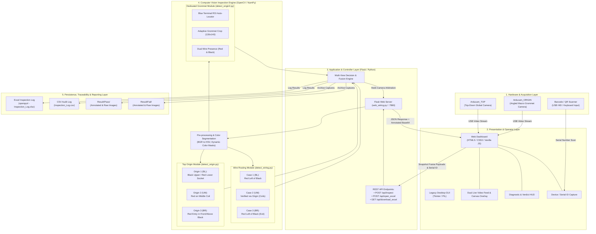
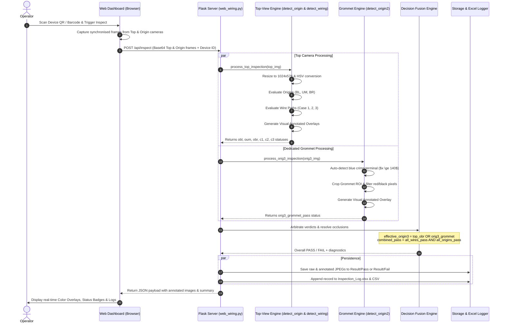
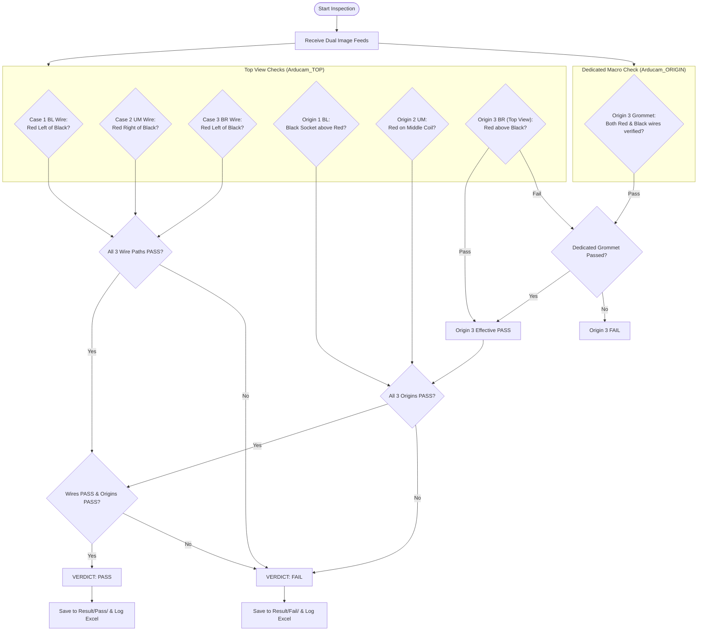

# System Architecture: Dual-Camera Wire Harness & Origin Inspection System

## 1. System Overview

The **Dual-Camera Wire Harness & Origin Inspection System** is an automated optical inspection (AOI) solution designed for industrial quality assurance of wire harnesses and PCB assembly origins. It combines multi-camera vision acquisition, custom color/spatial morphology analysis, multi-view decision fusion, operator tooling, and automated traceability logging.

---

## 2. High-Level Architecture Diagram

---

## 3. Detailed Dataflow & Inspection Pipeline

---

## 4. Multi-View Decision Fusion Logic

---

## 5. Subsystem Component Breakdown

| Layer / Component | Source File(s) | Primary Technology | Key Responsibilities |
| :--- | :--- | :--- | :--- |
| **Hardware & Devices** | `rename_camera.ps1`, `rename_camera.bat` | PowerShell, Win32 PNP | Registry-level USB camera renaming, multi-camera discovery, barcode scanner input |
| **Web Server & UI** | `web_wiring.py` | Flask, HTML5, CSS3, JavaScript | Single-page responsive operator dashboard, dual camera live preview, QR scanning, API endpoints |
| **Desktop GUI (Alt)** | `gui_wiring.py` | Tkinter, Pillow | Standalone desktop GUI fallback for direct local camera streams |
| **Wire Path Inspector** | `detect_wiring.py`, `web_wiring.py` | OpenCV, NumPy | HSV color segmentation, spatial moment analysis, connected component analysis across 3 critical routing ROIs |
| **Top Origin Inspector** | `detect_origin.py` | OpenCV, NumPy | Checks socket insertion polarity and inductor coil wiring terminals |
| **Dedicated Macro Inspector** | `detect_origin2.py` | OpenCV, NumPy | Blue terminal tracking, dynamic grommet ROI cropping, operator clothing noise rejection, wire presence validation |
| **CLI & Batch Pipeline** | `main.py` | Python 3 | Headless evaluation runner for test scripts, automated regression testing |
| **Data Logging & Excel** | `web_wiring.py` | openpyxl, CSV | Formatted, color-coded tabular audit logs with automated column resizing and freeze panes |
| **Packaging & Executable** | `web_wiring.spec`, `web_wiring.exe` | PyInstaller | Standalone portable zero-dependency executable for production deployment |
